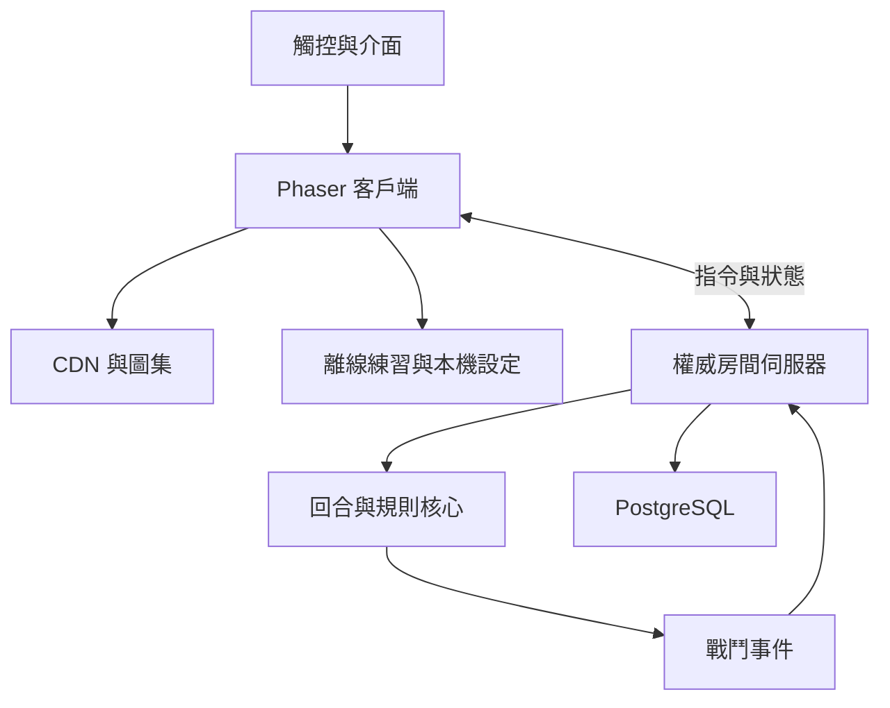
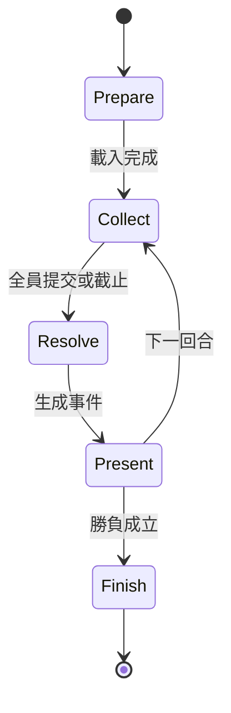

# 04｜技術架構、資料與多人連線

狀態：建議架構，待 M1／M3 以實測收斂。未安裝套件、未建立伺服器，也未宣稱任何效能結果。

## 1. 分工與選型

| 層 | 選擇 | 責任與理由 |
| --- | --- | --- |
| 遊戲客戶端 | TypeScript + Phaser | 地圖、角色分層、動畫、特效、鏡頭及輸入 |
| DOM 介面 | Vue + CSS | 登入、背包、任務、設定、聊天與可觸控按鈕 |
| 建置 | Vite + pnpm workspace | 圖集／資料分包、版本與共用模組 |
| 回合核心 | 純 TypeScript | 可重播結算；不依賴畫面或瀏覽器 |
| 房間服務 | Node.js + Colyseus | 地圖／組隊／戰鬥房間、權威狀態與斷線恢復 |
| 持久化 | PostgreSQL | 帳號角色、物品、任務、交易與戰果 |
| 靜態資產 | HTTPS 物件儲存 + CDN | 有雜湊版本的地圖、角色、音效 |
| 本機資料 | IndexedDB + Cache Storage | 設定、離線練習存檔、可重新下載資產 |

採用 Colyseus 的狀態同步能力見 [TECH-05](02-reference-and-reconstruction.md)。它不等於已完成資料庫、交易或防作弊；這些由本專案實作。Redis、跨區與多分片於負載有需要時再加入。

套件具體版本於 M1 查核官方相容性與安全更新後鎖定 lockfile；不能用「最新」作為可重現的版本。此選型針對外部 GitHub 專案，前端與長連線遊戲伺服器分開部署；靜態網站託管本身不能承擔持久戰鬥房間。

## 2. 系統關係

Vue 管介面狀態，Phaser 管畫面與每幀資料，透過型別化事件介面溝通；不能每幀把角色全部資料寫入 Vue 反應式狀態。世界位置採邏輯座標，投影成螢幕座標；地圖層提供碰撞、尋路與足點深度排序。

## 3. 建議目錄（尚未建立）

| 路徑 | 責任 |
| --- | --- |
| apps/client | PWA 外殼、Vue 介面、Phaser scenes、音訊與資產載入 |
| apps/server | 身分驗證、地圖／戰鬥／隊伍房間、資料庫服務 |
| packages/battle-core | 回合、技能效果、狀態、勝負與重播 |
| packages/protocol | 指令、事件、版本與資料驗證 |
| packages/content | 地圖、NPC、技能、物品、任務與來源記錄 |
| packages/avatar | 外觀描述、圖集契約、組合及遮擋資料 |
| tools/asset-pipeline | 來源匯出、打包、檢查與預覽工具 |
| tests | 核心、多人一致性、端到端及資產檢查 |
| docs | 本次規劃、後續決策與驗收證據 |

美術來源檔與發佈圖集分開。大型二進位資產不用普通 Git 反覆提交；CI 讀取有版本的資產清單。

## 4. 回合協定

1. 伺服器建立 battleId、rulesVersion、contentVersion、roundId、deadline 與初始狀態。
2. 客戶端提交 commandId、roundId、actorId、actionId、targetIds；不提交傷害、掉落或自己計算的餘額。
3. 驗證操作者權限、存活、消耗、目標、行動次數與截止；重送相同 commandId 返回既有結果。
4. 收齊指令或逾時後，依可配置規則排序；速度影響與同速規則需原作補證。測試版先用固定可重播規則，清楚標記。
5. RNG seed 僅在伺服器結算與受控重播使用；不能在玩家提交前公開可預測未來結果的亂數資訊。
6. 產生有 eventSeq 的攻擊、傷害、狀態及勝負事件；客戶端播放動畫，但不得修改結果。動畫 acknowledgement 只影響呈現等待，不能無限拖延回合。
7. 逾時預設防禦為重製初始設計，可配置。截止以伺服器時間為準，不相信本機倒數。
8. 結算使用唯一 battleResultId 的資料庫交易寫入獎勵與任務；重連或重送不能重領。

回合間換裝先由伺服器驗證；戰鬥中的允許時點與數值快照規則要核對原版。初版在戰鬥中拒絕換裝並顯示原因，不能偷偷改變已提交動作的屬性。

## 5. 多人與恢復

- 探索按區域訂閱同圖玩家，伺服器檢查移速與可達性。初期同區 50 人為測試目標，不是已測能力。
- 戰鬥房間與公開地圖隔離，只有授權隊員可控制自己的單位；聊天訊息不混入戰鬥狀態。
- 原型先設雙方各十個戰鬥實體、共二十個的效能場景；玩家、戰寵、神仙名額再依原作規則調整。
- reconnect 帶短期 token 與 lastEventSeq；伺服器傳 snapshot + 後續事件，序號較舊的資料不得覆蓋新狀態。
- 伺服器每回合提交狀態快照、截止時間、已接受指令及結算事件。程序重啟可還原；若無法恢復則中止該戰鬥，不發放部分或重複獎勵。
- 重新登入的同帳號多裝置策略首版為單一遊玩 session；新 session 取代舊 session 並顯示原因。
- App 退背景不等於全隊暫停。伺服器照常走回合；重回前景先同步，再開放操作。
- 斷線重連失敗須能回到角色／重試畫面，保留 server-side 進度，不停在黑畫面。

## 6. 資料邊界

| 實體 | 重要欄位／約束 |
| --- | --- |
| Account／Session | accountId、驗證資訊、sessionVersion、expiry；不將帳密寫入 repo |
| Character | ownerId、professionId、level、stats、mapId、position、revision |
| ItemDefinition | templateId、version、requirements、stats、visualId、sourceStatus |
| ItemInstance／Equipment | 唯一 instanceId、ownerId、quantity、slot、revision；同一件不可同時在兩個槽 |
| Appearance | bodyId、hairId、slotVisualIds、mountId、formId、appearanceRevision |
| Pet／Deity／Mount | 實例與定義分離，能力、技能與外觀來源可追蹤 |
| QuestProgress | questId、stepId、revision、rewardClaimId；一次性領獎唯一 |
| Battle／Command／Event | battleId、roundId、eventSeq、rulesVersion、冪等鍵 |
| InventoryLedger／Trade | 來源、去向、金額／物品、transactionId、交易狀態 |
| ContentReference | sourceUrl、targetVersion、confidence、reviewState |

背包容量、貨幣、掉落、交易由伺服器和資料庫交易維護。交易採預留→雙方確認→原子轉移；取消／斷線釋放預留。原版經濟尚未校準時用測試服數據，不導入付費功能。

登入首版採成熟身分驗證方案或經安全審核的帳密服務，M3 選定 provider 與部署環境後定案。HTTPS、WSS、短效 session、輸入結構驗證、頻率限制、聊天文字轉義與權限檢查列為上線必要工程，不把信任交給客戶端。

## 7. 發佈與營運

每次版本包含 clientBuildId、protocolVersion、rulesVersion、contentVersion、assetManifestHash。連線時核對相容區間；錯版返回可理解的更新訊息，不能靜默用舊公式結算新裝備。

CI 依序驗證資料／資產完整性、核心測試、多人協定與 build。測試部署通過後才推正式版本；伺服器採停止新房間→既有房間收尾／保存→更新的流程。前端保留上一版資產，避免正在遊玩的客戶端下載到 404。

記錄錯誤、載入失敗、房間人數、回合結算時間、重連結果與慢查詢，不記錄密碼或 session token。資料庫定期備份並實際演練恢復；正式前定義 RPO／RTO。M3 起記錄每百名同時在線的伺服器與流量成本，未選服務商前不提供虛假的固定月費。
