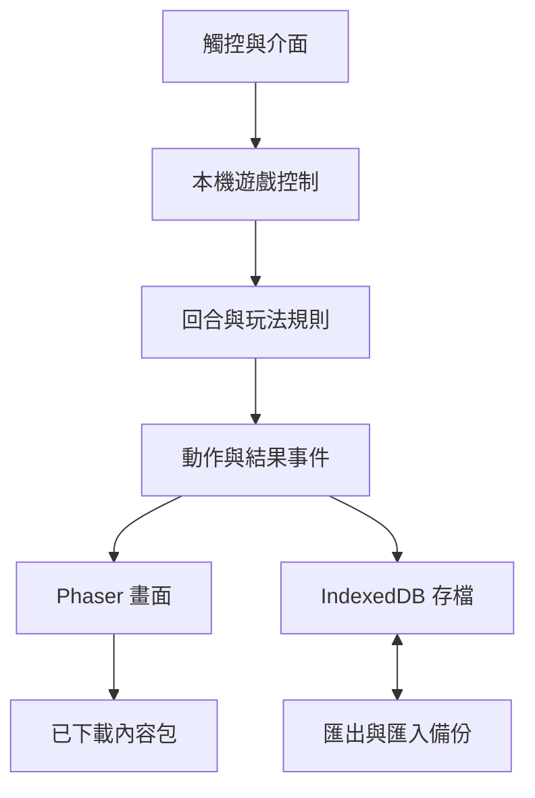

# 04｜單機架構、資料與存檔

> 0.1 實作已開始：本文件保留前期規劃，完成情形及技術調整請以 [09 實作現況](09-implementation-status.md) 為準；不能將規劃表格視為已交付功能。

更新：2026-10-12，v0.2。M1–M4 不開發／部署後端。Node.js 只可作本機建置工具，不代表需租用常駐伺服器。所有玩法與存檔可在玩家裝置運作。

## 1. 選型與模組

| 層 | 技術／職責 |
| --- | --- |
| 遊戲畫面 | TypeScript + Phaser：角色、圖集、地圖、動畫、特效與輸入 |
| 介面 | Vue + CSS：背包、任務、設定、存檔與觸控介面 |
| 建置 | Vite：純靜態輸出與按需資產包；鎖定套件版本 |
| 遊戲規則 | 純 TypeScript：回合、成長、任務、掉落；不依賴網路 |
| 進度 | IndexedDB：版本化且具交易邊界的本機存檔 |
| 資產 | Cache Storage：可重抓的圖集、音效、地圖及離線外殼 |
| 備份 | 玩家可匯出／匯入的存檔檔案，無雲端服務要求 |
| 發佈 | 免費 HTTPS 靜態託管；[候選比較](08-free-hosting-options.md) |

不安裝 Colyseus、PostgreSQL、登入 SDK 或即時雲端服務作為單機的必要依賴。只保留乾淨的函式和儲存邊界，避免為不存在的後端先建立繁複協定。

## 2. 資料流

Vue 不接收每幀全部角色位置；畫面與介面用型別化事件溝通。世界座標與螢幕投影分開，地圖包含碰撞、尋路與足點深度排序。

## 3. 建議程式結構（尚未建立）

| 路徑 | 責任 |
| --- | --- |
| apps/client | PWA、Vue 介面、Phaser 場景、音訊及輸入 |
| packages/game-core | 回合、敵方 AI、狀態、任務、物品與獎勵 |
| packages/content | 地圖、NPC、技能、物品及來源狀態 |
| packages/avatar | 分層外觀、動畫、遮擋及圖集契約 |
| packages/save | IndexedDB、格式版本、匯入匯出與遷移 |
| tools/asset-pipeline | 資產產生、打包、完整性及預覽 |
| tests | 玩法、存檔、離線與端到端測試 |

只實作 LocalGameSession 和 LocalSaveRepository；未來必要時再加入遠端實作。不要預先建立 apps/server 或要求連線才能通過健康檢查。

## 4. 本機回合與獎勵

Prepare→Collect→Resolve→Present→下一回合／Finish。玩家與敵方 AI 都提交同一類型指令，遊戲核心驗證行動、目標、資源及狀態。固定初始狀態、亂數狀態與指令可產生一致結果。

每場戰鬥有 battleId，每回合有 roundId，每次結算有 resultId。保存回合前狀態、已接受指令、亂數狀態、結算結果及可恢復階段；遊戲邏輯不由動畫幀率決定。

角色、物品、任務與已領取 resultId 在同一 IndexedDB 交易提交，成功後才顯示獎勵已儲存。關閉後可重播動畫或直接呈現結算，但不能再領一次。交易失敗則顯示儲存失敗並保留可重試狀態，不假裝成功。

退背景、直向提示及系統中斷可暫停單機倒數；返回後恢復，不能因瀏覽器背景計時節流跳過整場戰鬥。戰鬥內換裝初版限制在安全邊界，避免已提交動作的屬性被中途更換。

## 5. 存檔格式與生命週期

存檔包含 saveId、schemaVersion、contentVersion、revision、savedAt、角色／隊伍、背包、裝備、任務、地圖位置、戰鬥快照及 claimedResultIds。外觀由已穿戴物品解析，不重複存放容易不一致的能力值。

- 自動存檔：回合提交、戰果、任務交付、換裝、切圖等安全邊界；不等關閉頁面才存。
- 原子性：同一 save 的相關物件在同一交易中提交；保留上一個已驗證版本供恢復。
- 多分頁：每個存檔只允許一個可寫遊戲 session；以 IndexedDB 鎖／租約與 revision 條件更新防止舊分頁覆蓋，其他分頁提示已開啟。
- 匯出：使用者隨時下載備份，包含格式版本與完整性校驗；校驗用於偵測損毀，並非防修改安全保證。
- 匯入：限制檔案大小、解析 JSON 結構、檢查數值與內容 ID；不執行任何匯入程式碼。先匯入新存檔槽並顯示摘要，避免直接覆蓋原進度。
- 遷移：先保留舊版快照，再逐版遷移及驗證，成功後切換。遇到較新未知版本，保留原檔並說明版本不支援。
- 容量不足：先清理可重新下載資產；進度資料不自動刪除。提供匯出並提示修復方式。
- 清除網站資料／換瀏覽器／換裝置會影響本機進度；需靠備份搬移，不能宣稱自動雲端同步。

本機單機允許玩家掌控自己的資料；不投入線上防作弊、加密存檔保密或權威伺服器工程。未來若做多人，不能將可修改的本機存檔直接信任為線上貨幣與裝備。

## 6. 發佈與更新

建置包含 clientBuildId、saveSchemaVersion、contentVersion、assetManifestHash。使用 HTTPS 與預設免費子網域，無需購買網域或 VM。CI 只做前端 build、資料／資產檢查、核心及存檔測試。

資產按內容包提供完整清單與雜湊，全部完成後才能標示可離線。戰鬥時只提示更新；在安全邊界成功存檔後才切換外殼。保留舊資產直到新包完整，避免新舊混用或缺圖。

## 7. 最後才評估的後端

M5 為可選研究，不在本次開發依賴內。啟動前先確認單機效果、實際需求、同時在線人數與零費用限制。可能只需要備份同步，也可能需要真正組隊，兩者成本與架構不同。

雲端同步可評估 Supabase；多人房間可比較 Cloudflare Durable Objects 或 Node／Colyseus。這些都不是已定案選型，不能假設互相直接相容。只有選擇多人後，才實作帳號、權威回合、WSS、快照重連、交易冪等及伺服器持久化。

未來線上角色採新建或經驗證的受限搬移策略，不能承諾無條件繼承單機經濟。單機仍獨立保留且可遊玩。
