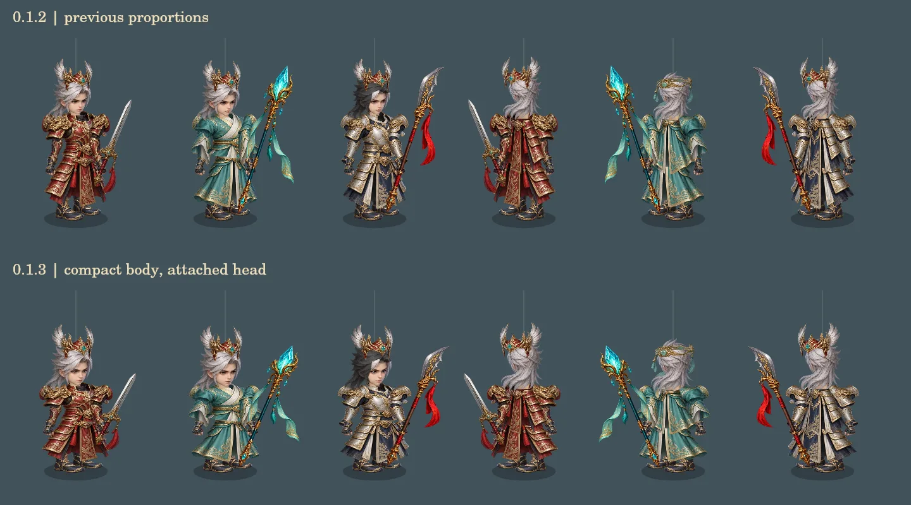
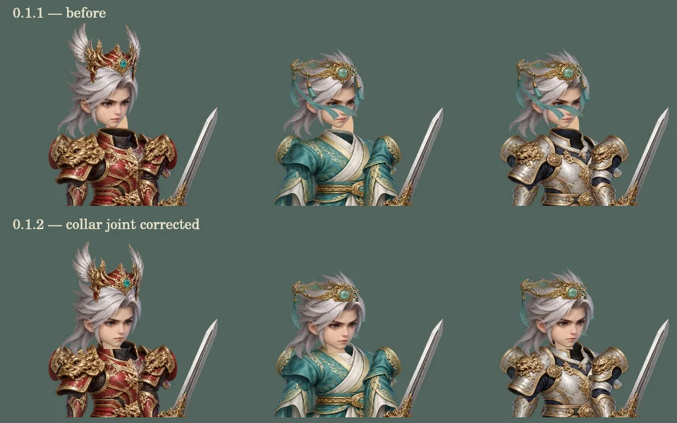

# 09｜0.1.3 實作現況與驗證

更新：2026-10-13（Asia/Taipei）。這份文件記錄實際程式；01–08 是保留的開發規劃，不能視作已通過的驗收。

## 交付範圍

第一章「風起青嵐」有兩張地圖、兩名 NPC、一次寶匣、普通遭遇、頭目、一條四階段任務、銅錢／丹藥／經驗與升級。城鎮可休息與買藥；死亡回城保留背包，撤退保留進度。單機存檔可以接續已結算的回合。

三套衣甲 × 三武器 × 兩頭飾，共 18 組混搭，另有兩色頭髮。各衣甲的軀幹、裙甲與手臂有獨立素材；刀劍、長戟、法杖的輪廓和持握不同，裝備數值由 ID 解析。赤雲騎乘提高探索移動速度，戰鬥時下騎。靈狐自動追擊或治療。

## 0.1.3 人物比例調整

- 身體寬度增加 8%、高度縮短 18%，讓肩膀、軀幹與腿部更緊湊。頭部等比例放大 10%，補償身體縮放，避免臉被壓扁；下巴仍固定在各衣甲的衣領接點。
- 城鎮角色縮放由 1.03 改為 0.92；戰鬥鏡頭留有指令區，角色縮放由 1.12 改為 1.30。頭目放大 15%，保留角色與大型敵人的差異。
- 名稱位置與點選範圍共用角色尺寸，NPC、玩家與騎乘標籤跟隨新高度；頭像取景同步調整。
- 以下為實際繪圖函式的離屏 Canvas 對照，不是手機瀏覽器截圖。仍需真機確認整體觀感。



## 0.1.2 頭頸接合修正

0.1.1 雖調整頭部尺寸，但使用者手機截圖仍顯示頭頸分離感。放大檢查發現：衣甲圖集的衣領開口是深色實心像素，先畫的頸部被衣甲覆蓋；原頸部橢圓也偏在下巴右側。僅縮放頭部不足以解決。

- 三套衣服各有衣領接點，正面頭部以圖集中的下巴位置對齊，後髮與頭飾共用接點。
- 改為衣甲 → 頸部 → 頭部 → 前衣領邊的遮擋順序，頸部接入衣領，移除偏位的橢圓。
- 玉簪緞帶先畫在後髮底下，前方只保留頭環；不再橫跨眼睛與鼻子。玩家、NPC、換裝預覽與頭像都使用同一個繪製函式。
- 以實際 Canvas 渲染檢查 720 組正面／側面方向、衣甲、頭飾、髮色、待機／行走／攻擊／施法／防禦／受擊及騎乘狀態；舊版衣領空洞的像素樣本會使這項檢查失敗。另視覺檢查三套衣甲的八方向圖層。
- 這是繪圖回歸檢查，不是瀏覽器或 iPhone 真機驗證。八方向仍使用素材變換，並未新增完整逐格方向圖集。



可選的繪圖檢查需要本機已存在的 `@napi-rs/canvas`，不是遊戲的執行或建置相依套件：

```sh
THEGODS_CANVAS_MODULE=/path/to/@napi-rs/canvas/index.js node scripts/check-hero-rig.mjs
```

## 0.1.1 手機與操作修正

- 調整前／後頭部大小，以衣領接點對齊下巴與後髮；冠飾一同縮放。靴子分左右抬腳，黑髮遮罩保留臉部膚色。這些是分件骨架修正，沒有新增完整角度素材。
- 舞台使用實際可見視窗與元素邊界，處理內嵌視窗大小和位移；Canvas、HUD、指標反算使用同一套座標。戰鬥背景覆滿舞台，人物鏡頭另保留上方 HUD 和下方指令列空間。
- 六個大型按鈕改為底部單排「攻擊／仙術／物品／防禦／撤退」。選招、選目標、確認是不同狀態，確認前可取消。只有確認後才結算、保存與播放動作。
- 場上人物從頭到腳皆可點選，也提供帶生命值的目標按鈕；全體術選定後標示所有存活敵人。回復只接受自己為目標。防禦、撤退必須確認；重複或過期指令會被阻擋。
- 大型中央橫幅和覆蓋戰場的戰報移除；回合狀態在指令列，完整戰報由右上按鈕開啟。幽火改為分層煙焰輪廓。
- 地圖與任務追蹤先走到出口再換區；點別處會取消帶路。場景按下後須放開才執行點擊，拖曳超過 12 CSS px 不會誤發移動。
- 存檔 schema 維持 1，可接續既有戰鬥；未確認的指令不寫入存檔，重新開啟後重選即可。

這版修正使用者截圖指出的問題，但仍須手機瀏覽器實測視覺與操作，不能視為完成驗收。

## ADR-001：先交付零相依靜態版本

前期規劃提出 TypeScript／Phaser／Vue／Vite。0.1 實際採用 **原生 ES Modules + Canvas 2D + HTML/CSS**，使用 Node 內建工具檢查和複製靜態輸出。這能先完成可離線遊玩的規則和互動，不需要安裝第三方依賴或 CDN。

`core.mjs` 保持純函式，`storage.mjs` 保持獨立儲存邊界，日後若場景／動畫規模需要再評估引擎遷移。沒有建立後端。

## 角色與視覺限制

採用本次生成的預渲染風格素材，再由 Canvas 分件裝配。附圖僅作視覺研究，沒有將整張參考截圖當遊戲人物。頭部、冠飾、手臂、軀幹、裙甲、手、靴、武器分開，材質不是只靠換色。

- 有八個方向輸入／預覽，但目前是前後素材配合鏡像、寬度和層次變換；不是八份精確角度圖集。
- 待機、行走、攻擊、施法有部件動作。腳部步態、坐姿、背面遮擋及其他基礎動作仍需專門素材和調整。
- 「銀／黑」是髮色差異，黑色以局部髮絲遮罩和濾鏡近似，尚非獨立黑髮圖集；兩種髮型尚未完成。
- 坐騎、戰寵、敵人使用獨立素材與位移／呼吸動畫；尚無完整八方向逐幀動畫。
- 不宣稱與參考逐像素一致；未完成同角度美術人工驗收。
- 地圖目前為背景圖及可行走範圍，不包含完整碰撞網格、繞障尋路或多層建築遮擋。

因此 M1／M2 只有部分項目已實作，正式里程碑仍未驗收；M3／M4 不宣稱完成。

## 存檔與離線邊界

- IndexedDB 的 `current` 與 `previous` 在同一個讀寫交易更新，revision 防止舊分頁覆寫。
- 介面等待保存完成才呈現新狀態，保存中阻止連續點擊。規則先結算、保存，再播放效果；動畫不發獎勵。
- 結算、換裝、切圖、到達目的地與任務都保存，背景事件只補存，不作唯一的保存時機。
- 本機讀檔會驗證數值、裝備、敵人與戰鬥狀態。格式不符時保護原資料，提供匯出、復原與匯入。
- 匯入有 256 KiB 上限和確認摘要；清除戰鬥並回到安全位置。上一份有效存檔可在設定預覽後復原。
- IndexedDB 無法啟動時使用 localStorage 備用；localStorage 版本比對不保證兩分頁真正同時寫入的原子性。請避免同時遊玩兩個分頁。
- 目前沒有內容雜湊式存檔校驗或跨 schema 遷移，較新未知版本保留且拒絕覆寫；損毀的底層資料可能仍需外部 JSON 備份復原。
- 建置以所有源碼／資產計算快取版本。完整下載成功才啟用新 SW，現有 SW 只讀自身版本快取。戰鬥內不允許按下更新；安全邊界保存後更新。
- 初次下載與版本更新需要網路；遊戲流程不依賴網路服務。私人託管驗證與瀏覽器清理快取可能影響離線啟動，需真機驗證。

## 已執行的驗證

| 檢查 | 實際結果 |
| --- | --- |
| `npm test` | 27 項通過 |
| 核心測試 | 18 組裝備、固定亂數、無效指令、防禦、勝敗、任務、獎勵不重領 |
| 完整流程測試 | 起始裝備與資源打完普通遭遇／頭目並交付；每回合序列化再恢復 |
| 存檔測試 | 匯入驗證、已結算戰鬥重開、備用槽保存、舊分頁衝突、配額錯誤、損毀 JSON 不擦除 |
| 指令回歸 | 取消不改存檔、精確目標、自身治療、無效／過期目標、防禦撤退確認、重複提交、舊戰鬥接續 |
| 版面數學檢查 | 844×390、932×430、667×320、728×300、1194×557；含安全區的戰場邊界及觸控反算 |
| `node --check` | 應用、繪製及 Service Worker 語法通過 |
| `npm run check` | 預載檔案齊全、manifest 橫向、沒有外部執行期依賴、單檔大小符合限制 |
| `npm run build` | 產生 dist 與依內容更新的 SW 快取名稱 |
| 圖層檢視 | 使用離屏 Canvas 實際繪製城鎮、三套衣甲、坐騎、敵人與場景，修正素材邊界和顯示問題；0.1.1 另對照三套衣甲正背面、銀黑髮色、冠飾及短畫面戰場（僅 Canvas） |

離屏圖片不是瀏覽器畫面或真機測試。當前環境缺少 Sites 支援的瀏覽器 QA 能力，因此沒有啟動替代瀏覽器測試，也沒有聲稱通過。

## 尚待操作驗證

1. iPhone Safari 與主畫面模式、Android 瀏覽器與安裝模式，分別完成第一章。
2. 橫向安全區、短高度畫面、圖層觸控目標、面板捲動、鍵盤操作。
3. 初次下載、飛航重啟、儲存容量不足、關頁再開與 IndexedDB 真實交易中斷。
4. 兩分頁衝突、戰鬥中載入更新、關閉或切背景後恢復。
5. 30 分鐘真機效能／耗電、字型與圖像解碼、與參考的比例和各方向對照。

四職業、完整角色創建、合成、其他章節／地圖及全部原規劃內容尚未實作。下一步優先依使用者試玩回饋修正手機操作與角色，再擴充單機內容。後端維持最後且未啟動。
